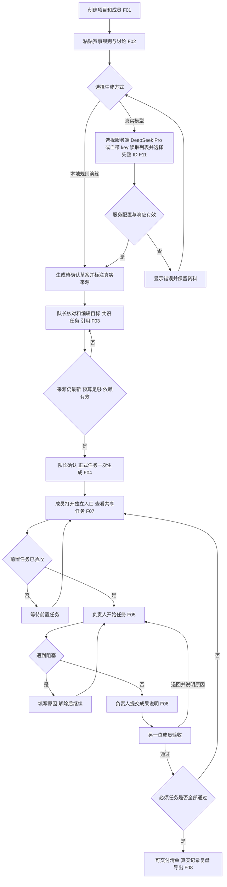

# 业务流程

日期：2026-10-26。流程节点与需求 F01—F11 对应。浏览器可查看 `/workflow` 的图形版。

## 贯穿流程的错误分支

- 所有项目请求都验证成员身份。错误口令、跨项目访问、自行改变身份不能绕过后端检查。
- 模型分支：默认 DeepSeek-V4-Pro / deepseek-v4-pro。使用自带密钥时先读取可信服务的模型列表，再选择完整 ID；密钥仅本次进程内存有效，读取列表未成功不能猜模型名。生成草案分别保存请求和服务响应模型标识。
- 对可修改的草案和任务带上 `expected_version`。其他成员已改动时返回 409，刷新后核对再操作。
- 确认草案前可补充原文；补充后必须重新生成，不能确认旧草案。
- 确认后资料冻结、方案不可重复确认；执行中采用阻塞和验收退回来协作。
- 负责人点击提交后状态为“待验收”，尚未完成；只有另一名成员通过才能解锁依赖。
- 提交准备页可以随时查看；只有全部必须任务已通过才标记“可交付”。本地规则复盘为统计与模板建议，不伪装成大模型分析。
- 读取在服务重启后仍应得到相同的数据库记录，见 F09。

## 人工操作路线

1. 队长创建两人项目，复制胡的成员入口，保存自己的入口。
2. 添加一份规则和一份讨论，选择规则演练，检查来源标记。
3. 编辑目标及任务，确认分工；尝试由普通成员确认，检查拒绝。
4. 第二浏览器打开胡的入口，确认两人看到相同任务。
5. 负责人开始任务、记录一次阻塞、解除、提交成果；尝试自验，检查拒绝。
6. 另一人退回一次，再由负责人修改成果后重新提交，另一人通过。
7. 完成所有必须任务；查看“可交付”、清单、复盘和 Markdown 导出。
8. 用旧版本请求验证冲突提示，并重启测试服务验证数据仍在。
